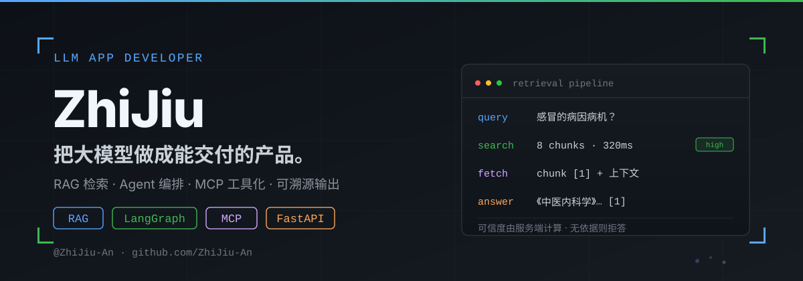

  

  <a href="#-核心能力">核心能力</a> ·
  <a href="#-精选项目">精选项目</a> ·
  <a href="#-技术栈">技术栈</a> ·
  <a href="#-联系">联系</a>

***

## 关于我

我是安枳杦，大模型应用开发领域探索者，专注于RAG、Agent开发、业务场景快速落地、模型微调与部署能力。我做的事是把 LLM 从能跑通的 demo，做成能上线、可维护、成本可归因的成熟产品。而检索增强、参数微调、多 Agent 编排、MCP 工具接入，都是这条路上的环节。

> **怎么把大模型做成能交付的产品。**

落到具体工程里是三条：

- **工具有边界** — 只给模型它有权限用的工具和上下文：检索只给片段，MCP 只暴露必要工具，Agent 限制可执行范围；
- **链路可追溯** — 每个结论、每次工具调用都能回溯：检索带 `chunk_id`，Agent 带 checkpoint；
- **失败可恢复** — 出错不静默填充：抽取失败进复核队列，链路断了从 checkpoint 续跑。
- **成本可归因** — 每个工具调用、每个 Agent 执行都能记录成本：MCP 有日志，Agent 有 checkpoint。
- **项目可维护** — 每个组件都有清晰的接口、文档、测试：代码质量高，可维护性好。

***

## 核心能力

- **检索增强（RAG）** — 文档解析、切片、向量化、检索、引用溯源全链路；可信度由服务端计算，无依据拒答。落地：retrieval-mcp
- **模型微调与部署** — LoRA / QLoRA 微调 + SFT 全流程（数据准备 → 训练 → 权重合并 → 验证），Ollama / vLLM 本地推理服务部署
- **多 Agent 编排** — LangGraph 多节点编排 + checkpoint 断点续跑，把「plan → fetch → diff → analyze → report」这类多步任务做成可恢复的管道。落地：competitor-intel
- **MCP 工具化** — 自建 stdio MCP Server，把外部能力封装成 AI 可调用的工具（检索、爬虫等），并做好权限与超时边界。落地：retrieval-mcp、competitor-intel
- **全栈交付** — FastAPI 后端（SSE 流式、JWT 鉴权）+ Vue 3 / Tauri 2 桌面端 + Taro 4 小程序，从接口到界面一条链路。落地：词札、CanDo

***

## 精选项目

| 项目                                                                    | 是什么                                                                                                                                            | 技术栈                                                         |
| --------------------------------------------------------------------- | ---------------------------------------------------------------------------------------------------------------------------------------------- | ----------------------------------------------------------- |
| **[retrieval-mcp](https://github.com/ZhiJiu-An/retrieval-mcp)**       | 只读检索 MCP Server：对 AI 只暴露 `list_sources` / `search` / `fetch` 三个工具 + 一个文档资源；BM25 + 向量混合召回、RRF 融合，ACL / 密级 / 文档状态前置过滤；返回片段与可信度，附评测门禁与 CI（v0.1.0） | Python · MCP · BM25 + 向量 · SQLite · Pydantic                |
| **[词札 · cizha-vocab](https://github.com/ZhiJiu-An/cizha-vocab)**      | 面向 AI / 大模型从业者的英文术语记录本：词典与领域解读双源查询、间隔重复复习、图片取词，带 macOS 原生桌面版（v0.2.3，216 个后端测试）                                                                 | Python · FastAPI · Vue 3 · SQLite · Tauri 2                 |
| **[competitor-intel](https://github.com/ZhiJiu-An/competitor-intel)** | Schema 契约驱动的竞品情报管道：结构化抽取 → 字段级 diff → 可审计的 Markdown 报告；内容指纹未变时短路 LLM，抽取失败永久落库                                                                  | Python · LangGraph · Crawl4AI · Playwright · Pydantic · MCP |
| **[CanDo · 我的厨房](https://github.com/ZhiJiu-An/CanDo)**                | 个人菜谱管理微信小程序：菜品、食材、步骤一站式管理，支持分类搜索、收藏置顶，用 11 个云函数完成完整数据链路                                                                                        | TypeScript · Taro 4 · React 18 · 微信云开发                      |

> 四个项目都跑在真实场景里：retrieval-mcp 有评测门禁、CI 和 v0.1.0 发布；词札有可安装的 `.dmg` 和 216 个测试；competitor-intel 有 CI、断点续跑和零消耗短路；CanDo 的分类缓存与云函数链路都已落到实际代码里。

***

## 技术栈

- **LLM 应用**：RAG（解析 / 切片 / 向量化 / 检索 / 引用溯源）、LangChain、LangGraph（checkpoint 断点续跑）、Schema 约束抽取
- **模型微调与部署**：LoRA / QLoRA、SFT、Ollama、vLLM
- **后端**：Python、FastAPI、SSE 流式、Pydantic、SQLite、JWT、Celery
- **抓取与抽取**：Crawl4AI、Playwright
- **桌面 / 前端**：Vue 3、Tauri 2、React 18、Taro 4（微信小程序）
- **工程化**：MCP Server（stdio）、pytest、ruff、mypy、GitHub Actions

***

## 联系

- GitHub：[@ZhiJiu-An](https://github.com/ZhiJiu-An)
- 如果你也在做 RAG / Agent 的企业落地，欢迎在对应仓库开 Issue 交流。

***

  做有用的东西，不做好看的 demo。

